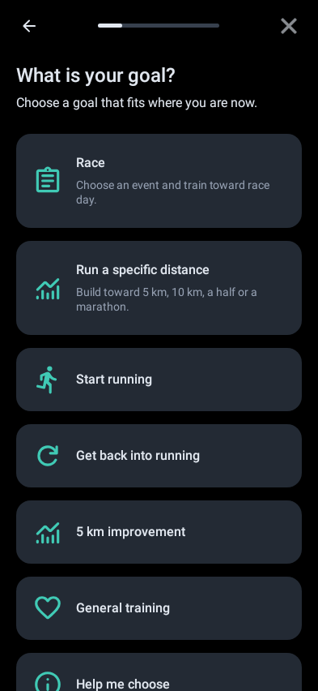
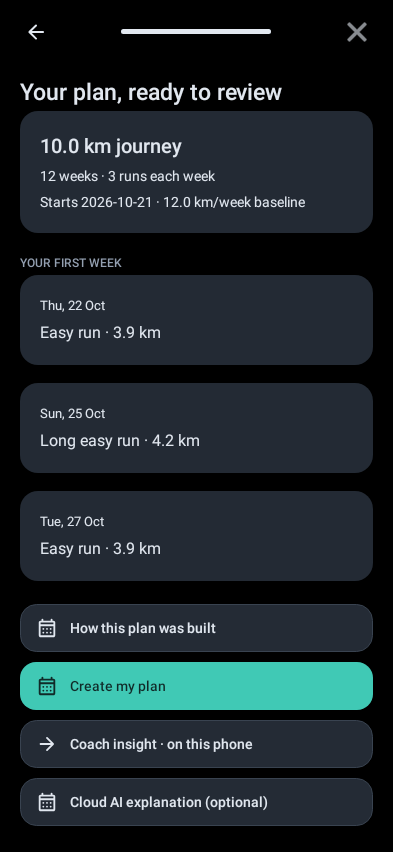
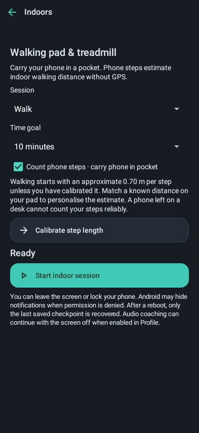
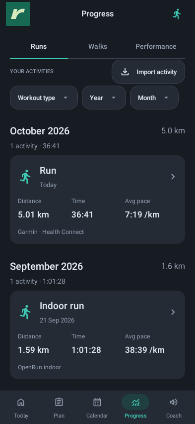
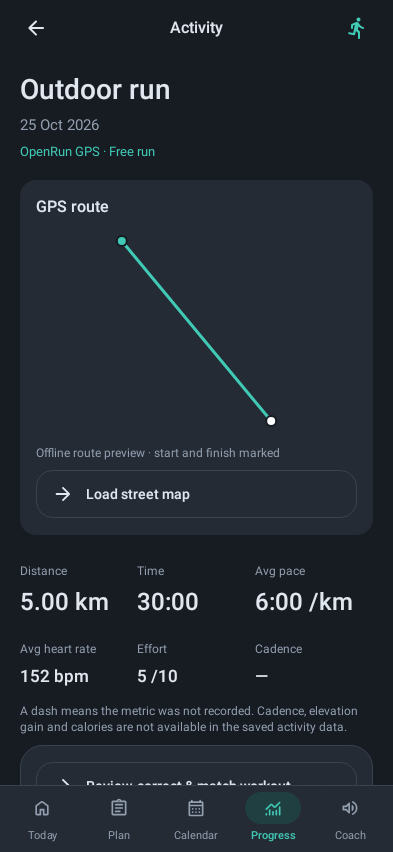
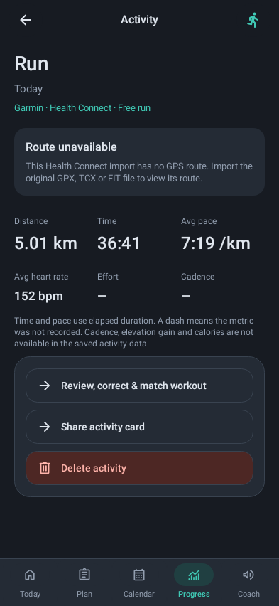

# OpenRun

**Plan your next run. Record your walks. Keep your training on your phone.**

A native Android running and walking app with original branding and code, offline training plans, GPS recording, audio cues and a locally cached race catalogue. Built with Java 17, Android Views and Android framework services.

[Build checks](https://github.com/mmphego/OpenRun/actions/workflows/ci.yml) · [APK releases](https://github.com/mmphego/OpenRun/releases) · [Contribute](CONTRIBUTING.md) · [Roadmap](ROADMAP.md) · [Changelog](CHANGELOG.md)

> **Beta · licensing decision pending.** No project-wide licence was present in the recovered source. This is a public-source collaboration candidate, not yet a fully licensed open-source project. Third-party licences remain in force. See [LICENSING.md](LICENSING.md). No Runna affiliation or feature-parity claim is made.

## What it does

| Area | Implemented | Limits |
| --- | --- | --- |
| Training | Goal/race-date plans, weekly scheduling, run/walk phases, pace estimates and reviewed adaptations | Original rules; qualified coach review remains outstanding. No automatic pain-hold clearance. |
| Personal voice coach | Next-run lessons, effort checks, optional live HR reminders, reflections and reviewed beginner run/walk stages with undo | [Behaviour and limits](docs/VOICE-COACH.md); original training rules and physical audio still need acceptance. |
| Outdoor recording | GPS routes, splits, pause/resume, recording diagnostics, recovery checkpoints and audio coaching | Physical-device/background accuracy still needs acceptance testing. |
| Indoor walking | Timer, optional phone-step distance estimate, calibration and movement reminders | Not a treadmill connection. Phone sensor availability and placement matter. |
| Progress and data | Local activity and plan-change history, reviewed safe undo, activity file import/export and encrypted portable backup | Protect exports: they can contain routes and health data. |
| Races | Top Events and Bield adapters, provider-aware merging, Room database, incremental content upserts, source links and saved races | Coverage depends on providers. Unknown facts stay unknown. RunSignup is disabled until operator approval/proxy configuration. |
| Background updates | One JobScheduler job on each foreground session, debounced across navigation; in-process guard plus expiring DB lease | Android decides execution timing. Network failures retain cached races. No startup network wait. |
| Health Connect | Separate read/write consent; recent run/walk import and reviewed original outdoor/indoor recording exports | Android 14+; optional average HR read, no routes or imported-activity re-export. Device acceptance pending. |
| Daily movement & recovery | Working-hour step-based reminders, 60+ minute intervals, 3+ minute walks, private check-ins and optional sleep/RHR context | Opt-in Android 14+ Health Connect background steps; missing/stale data suppresses alerts. Manual check-ins work offline on Android 8+. Device acceptance pending. |
| Optional integrations | Bluetooth heart-rate; self-hosted account/backup/Strava service | Permissions, compatible hardware/provider and operator configuration required; live service validation incomplete. |
| AI Coach | Bring your own OpenAI/Gemini API key, recent-run-based pace/distance proposals, coach questions and opt-in automatic post-run reviews with notifications | Validated easy-run adjustments; API billing/internet required. [Setup and limits](docs/AI-COACH.md). Live provider/device acceptance pending. |
| Offline AI explanations | Local LiteRT-LM adapter and consent-based server explanation endpoint | Gemma weights are optional; explanations cannot change workouts. |
| Garmin account sync | **Not implemented** | Official partner approval, credentials and integration work required. File import is separate. |

The app was previously named Rwun. Its Android package ID `app.rwun`, storage keys and backup formats are retained for compatibility; the display name and distribution name are OpenRun.

The current source candidate is **OpenRun 1.7.2 / local versionCode 28**, adding [daily movement and recovery](docs/DAILY-HEALTH.md) alongside [plan-change history and safe undo](docs/PLAN-CHANGES.md) and [Health Connect reading and writing](docs/HEALTH-CONNECT.md) to the recovered 1.5.0 implementation. Published builds use an automatic increasing versionCode and tags such as `v1.7.2-build.<code>`. A compatible APK upgrade requires the same signing certificate as the installed app.

The current focus is **running and walking**. Historical cycling and strength support code remains in the source to preserve completed work; it is outside the active product roadmap.

## UI images

These are real Android Views from the Rwun baseline rendered by the existing Robolectric Native Graphics tests with synthetic data, **not photographs, mockups, emulator captures or S23 acceptance evidence**. They show the recovered Rwun 1.4.4 planning and walking screens. The new provider catalogue screen is not pictured.

<p>



</p>

The Progress redesign below is rendered from the current native Android Views with synthetic activities. Running history uses monthly groups and compact metrics; activity details show saved routes with an optional inline street map. Health Connect imports without route data show an explicit unavailable state. These are host renders, not device acceptance evidence.

<p>



</p>

Device captures of the current build are a [starter contribution](CONTRIBUTING.md#good-first-contributions). Do not include personal routes or health records in screenshots.

## Install an APK

1. Download a signed APK and its `.sha256` file from [Releases](https://github.com/mmphego/OpenRun/releases), **when a release has been published**. No signed public release is promised by this README.
2. Verify it: `sha256sum -c OpenRun-1.7.2-BUILD-release.apk.sha256` (macOS: `shasum -a 256 -c OpenRun-1.7.2-BUILD-release.apk.sha256`). Adjust the filename for the release.
3. Open the APK on an Android 8.0+ phone and allow installation from that download source, or run `adb install -r OpenRun-1.7.2-BUILD-release.apk`.
4. Grant recording permissions when needed. Use an installed offline TTS voice for offline audio coaching.

For isolated developer testing, open a successful [CI run](https://github.com/mmphego/OpenRun/actions/workflows/ci.yml), download its versioned `OpenRun-<version>-<code>-<commit>-debug.apk` artifact, unzip and install the APK. Artifact download may require GitHub sign-in; retention is 14 days. Debug builds are for testing and may have different signing certificates. **Do not uninstall or clear data to apply an update.** Keep your existing app installed if Android rejects a certificate. Distribution updates must pass package/certificate/version checks and an in-place upgrade retention test; CI debug artifacts are not supported distribution updates.

## Develop from a clean clone

Requirements: JDK **21** (Java source level 17), Python **3.12**, Android SDK platform **36**, Build Tools **35.0.0**, platform-tools, Git and internet for initial dependencies. The project commits Gradle **8.11.1** and its wrapper checksum, Android Gradle Plugin **8.9.1**, Room **2.6.1**, desugaring **2.1.4** R8 **9.5.26** and Android Lint **9.4.0**. R8 is explicitly upgraded for the current LiteRT runtime; do not remove that pin without testing dexing.

```bash
git clone https://github.com/mmphego/OpenRun.git
cd OpenRun
cp local.properties.example local.properties
# Edit sdk.dir to your Android SDK path, or let Android Studio create this file.
sdkmanager "platforms;android-36" "build-tools;35.0.0" "platform-tools"
python3 -m venv .venv
source .venv/bin/activate
python3 -m pip install -r server/requirements.txt
./gradlew --version
bash scripts/check.sh
```

Windows: use Android Studio with JDK 21 and `gradlew.bat` for Gradle tasks; the standalone shell regressions require WSL or Git Bash. No release keys, cloud accounts, Garmin credentials or model weights are required to build the debug APK.

```bash
./gradlew :app:assembleDebug
adb install -r app/build/outputs/apk/debug/app-debug.apk
./gradlew :app:assembleDebugAndroidTest
adb install -r app/build/outputs/apk/androidTest/debug/app-debug-androidTest.apk
adb shell am instrument -w app.rwun.test/app.rwun.SmokeInstrumentation
```

Do not use `connectedDebugAndroidTest` as a substitute for the command above: this project retains a custom Android instrumentation runner rather than an AndroidX/JUnit device test suite.

## Configuration

- Core planning and recording work without an account or a service.
- Race refresh automatically contacts Top Events/Bield when Android runs the network-constrained job. No personal training records are sent to those catalogue providers. The public endpoints receive ordinary request metadata such as IP address.
- `app/src/main/res/values/race_providers.xml` keeps RunSignup disabled. Enable it only with the required approval and an HTTPS proxy that holds caller credentials server-side. Never place secrets in Android resources: APKs can be inspected.
- For the optional service, copy `server/.env.example` to `server/.env`, configure only the integrations you intend to operate, and follow [server/README.md](server/README.md). No service is deployed for you.
- AI Coach setup, data sharing and automatic reviews: [AI-COACH.md](docs/AI-COACH.md). Keys stay encrypted on the device and are excluded from training backups.
- Local model setup and terms: [OFFLINE-COACH.md](docs/OFFLINE-COACH.md). Weights are not included.
- Release signing: [docs/RELEASING.md](docs/RELEASING.md). No Google Play setup is used. Run `bash scripts/configure-signing.sh` on your machine once to configure a persistent signing key and public certificate pin. Distribution never falls back to runner-generated keys.

## Architecture

| Layer | Main components | Responsibility |
| --- | --- | --- |
| Native UI | `MainActivity`, `RacePlanActivity`, `RaceDiscoveryActivity`, `UiKit`, `PlanningUi` | Android Views, plan previews and user-reviewed changes |
| Domain | `PlanEngine`, `WorkoutEngine`, `RaceTraining`, `AdaptiveCoach`, `GpsAccumulator` | Testable training rules, workout transitions and GPS filtering |
| Recording | `TrackingService`, `IndoorStepService`, `HeartRateClient` | Foreground recording and device adapters |
| Local data | `RunStore`, `ActivityFiles`, `BackupManager`, `RaceDatabase`, `RaceRepository` | Existing training storage plus a separate Room race catalogue |
| Race ingestion | `RaceProvider` adapters, `RaceHttp`, `RaceSyncCoordinator`, `RaceSyncJob`, `RwunApplication` | Bounded provider fetches, conditional HTTP, transactional upserts, foreground scheduling and concurrency control |
| Optional service | `server/` | Independently hosted encrypted backup and approved integrations |

Race content, provider observations and saved user choices have separate write lifecycles. Identical content hashes skip edition/distance rewrites; last-seen and sync metadata still update. Conservative merge keys require matching name/date/known country, compatible cities/terrain, and a matching venue or exact event URL. Ambiguous matches remain separate. Complete provider reconciliation is bounded; failed/incomplete fetches do not wipe the catalogue. Schema 1→2 migration preserves either previous catalogue layout. See [race ingestion](docs/RACE-SYNC.md).

## Tests and checks

```bash
python3 scripts/run-host-tests.py
./gradlew :app:lintDebug :app:testDebugUnitTest :app:assembleDebug :app:assembleDebugAndroidTest
python3 -m unittest discover -s server -p 'test_*.py' -v
python3 -m unittest discover -s tests/device -p 'test_*.py' -v
```

Host regressions compile/run the existing Java test programs; the runner downloads two checksum-pinned test-only JARs and emits logs/JUnit XML under `build/reports/host`. Gradle tests include the recovered `tests/native` suites, Room upserts, both schema-1 migration paths, cross-provider merging, saved choices and database leases through Robolectric. Each test class runs in a fresh worker process; the live-provider test is skipped by default. Native UI renders are host evidence, not emulator or S23 acceptance. Android Lint is the current static analysis gate; no separate formatter or static analyser is claimed. Device QA utilities and the physical acceptance checklist are under [tests/device](tests/device/README.md) and [tests/s23](tests/s23/CHECKLIST.md).

CI runs on PRs and pushes to `main`, with read-only permissions and no secrets. It verifies both debug APK signatures and ZIP alignment before uploading the app APK for 14 days and reports for 7 days, including failure reports. Superseded CI runs are cancelled. Pushes to main (including PR merges) and version tags run the separate signed release workflow after full checks. Each main build publishes a versioned APK, checksum and generated release notes to [Latest release](https://github.com/mmphego/OpenRun/releases/latest) after stable signing secrets and a certificate pin are configured. See [release setup and versioning](docs/RELEASING.md). [Validation status](docs/PUBLICATION-VALIDATION.md) distinguishes completed checks from unavailable device/remote checks.

## Collaborate

Start with [CONTRIBUTING.md](CONTRIBUTING.md), [ROADMAP.md](ROADMAP.md), [issues](https://github.com/mmphego/OpenRun/issues) and the [pull request template](.github/PULL_REQUEST_TEMPLATE.md). Read the [Code of Conduct](CODE_OF_CONDUCT.md) and report vulnerabilities using [SECURITY.md](SECURITY.md). Maintainers must resolve licensing before accepting code under an assumed licence.

Documentation organisation and contributor onboarding were informed by [openGym](https://github.com/DuarteSantos8/openGym). Its implementation, assets and licence were not copied into OpenRun. Original release notes remain in [docs/HISTORY.md](docs/HISTORY.md); historical claims there may be superseded by this README and the roadmap. Third-party notices: [docs/THIRD-PARTY.md](docs/THIRD-PARTY.md).
