# OpenRun user manual

> **Beta guide.** Screens and features can differ between builds. This manual describes documented functionality on the repository's main branch; some device/provider integrations still require acceptance testing. OpenRun is not a medical device or a substitute for clinical advice.

## Contents

1. [Install and update](#install-and-update)
2. [Find your way around](#find-your-way-around)
3. [Create a training plan](#create-a-training-plan)
4. [Record an outdoor run or walk](#record-an-outdoor-run-or-walk)
5. [Record an indoor walk](#record-an-indoor-walk)
6. [Review progress and change your plan](#review-progress-and-change-your-plan)
7. [Configure AI Coach](#configure-ai-coach)
8. [Use Health Connect](#use-health-connect)
9. [Discover races and use other devices](#discover-races-and-use-other-devices)
10. [Manage your data and privacy](#manage-your-data-and-privacy)
11. [Troubleshooting](#troubleshooting)
12. [Safety and limitations](#safety-and-limitations)

## Install and update

OpenRun supports Android 8.0 and later. Check [GitHub Releases](https://github.com/mmphego/OpenRun/releases) for a published APK and checksum; availability of a signed release is not guaranteed.

1. Download the APK and matching SHA-256 checksum file, if provided.
2. Verify the checksum according to the release instructions.
3. Allow installation from your download source when Android prompts you, then install.
4. Open OpenRun and grant permissions only when you use the relevant feature.

**Important:** An update must use the same Android signing certificate and a newer version code. Do not uninstall the existing app, clear storage, or overwrite data to work around an installation failure. A CI debug APK may be signed differently from a release APK. Back up your data before changing builds. See [installation notes](../README.md#install-an-apk).

## Find your way around

The bottom navigation offers **Home**, **Plan**, **Calendar**, **Progress**, and **Coach**, even without an active plan. **Home** returns to the start screen. The settings icon opens **Profile**.

- **Home:** entry points for training, recording and common actions.
- **Plan:** create or review a training schedule.
- **Calendar:** view scheduled workouts.
- **Progress:** inspect saved activities and trends.
- **Coach:** training guidance, reflections and plan-change information.
- **Profile:** permissions, integrations, audio, data and AI Connections.

If a label differs on your build, use the closest corresponding section; report a mismatch with your installed version and a screenshot containing no personal data.

## Create a training plan

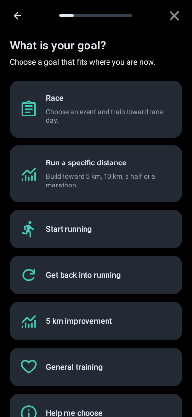

*Goal selection. This is a synthetic-data host render of an earlier Rwun baseline, not a current-device screenshot.*

1. Open **Plan** and start goal/race onboarding.
2. Select a goal or race, your current running baseline, the number of weeks and training days.
3. Review the generated schedule, including easy days, harder sessions and recovery.
4. Inspect **Review all workouts** before choosing **Create my plan**.
5. Use **Calendar** or **Plan** to see upcoming sessions.

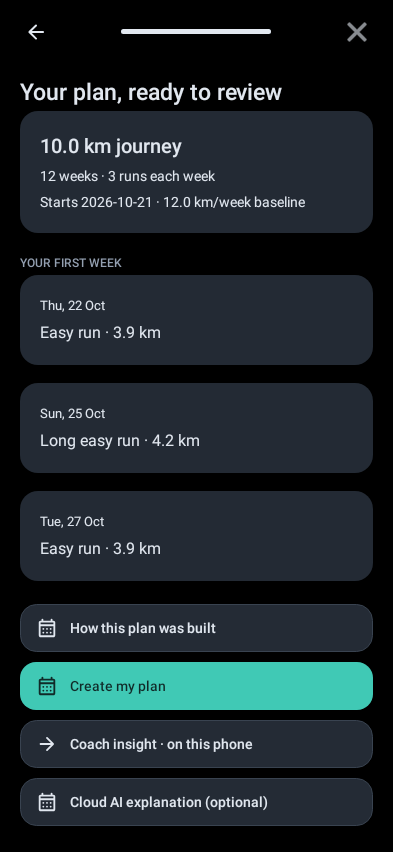

*Example plan preview from the earlier baseline. Confirm labels and controls against your installed version.*

The offline deterministic planner works without an account, API key or internet. The AI-personalised planning option requires [AI Coach configuration](#configure-ai-coach) and a working provider. AI plans are checked against the deterministic safety envelope; generating a preview does not automatically replace a saved plan.

**Pace terminology:** a target of 7:00 min/km means seven minutes per kilometre; a smaller number is faster. A goal pace is a target, not evidence of current readiness. Record real runs and feedback so adaptations can use observed performance.

## Record an outdoor run or walk

1. Open the recording entry point from **Home** and select the appropriate running or walking activity.
2. Allow location access when requested; use precise location for GPS routes where supported.
3. Wait for a usable GPS fix when possible, then start recording.
4. Use **Pause** and **Resume** when stopping and restarting.
5. Finish and save the activity; review its summary under **Progress**.

The recorder supports GPS routes, splits, audio cues and interrupted-session recovery. GPS quality varies with buildings, weather, device power restrictions and permissions. Do not assume a missing route can be reconstructed. For screen-off recording and audio checks, see [device acceptance](../tests/s23/CHECKLIST.md).

## Record an indoor walk

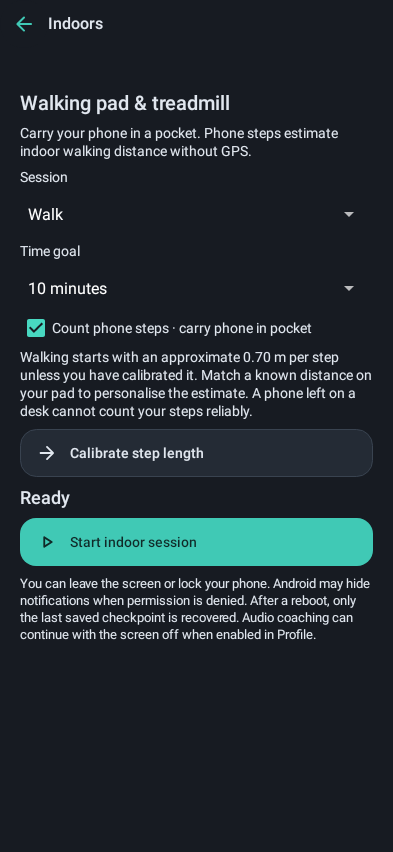

*Indoor walking example from the earlier baseline; actual device layout may differ.*

Use the indoor walking entry point, start the timer and save when finished. On supported phones, OpenRun can estimate distance from phone steps and a calibrated stride. Keep the phone positioned consistently; an estimate is not a treadmill-measured distance. Indoor walking does not require a GPS route or direct walking-pad integration. If step sensors are unavailable, record the supported time-only activity rather than inventing a distance.

## Review progress and change your plan

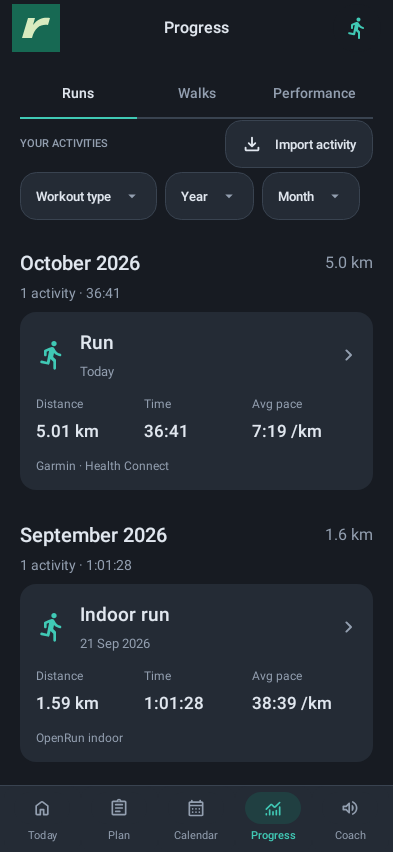

*Current native Android Views rendered with synthetic activities; not a physical-device capture.*

**Progress** groups saved activities and shows available distance, time, pace and route details. Imported records may have no GPS route or pace. Running and walking totals are kept separate.

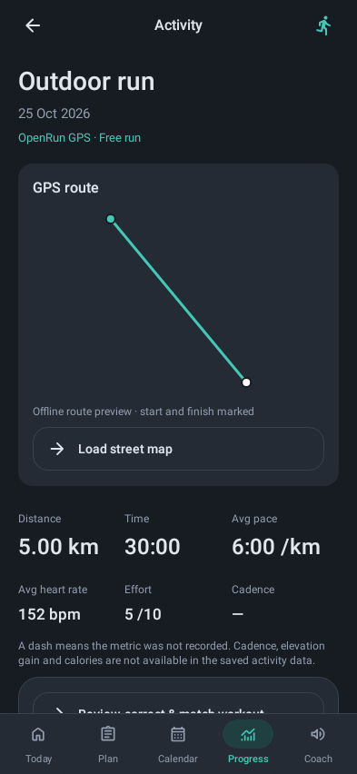

*Example route detail using synthetic data. Never share personal GPS routes in documentation screenshots.*

After a workout, provide effort, fatigue or pain feedback when prompted. Training adaptations are conservative: they protect completed sessions and recovery holds. Review proposed changes rather than assuming every run should make the next workout harder.

Open **Plan → Plan changes** or **Coach → Plan changes** to inspect the reason and before/after targets. **Apply undo** is available only for the newest eligible change; completed workouts, subsequent changes and safety holds can prevent undo. Undo never deletes recorded activities or clears a pain hold. See [plan-change rules](PLAN-CHANGES.md).

## Configure AI Coach

AI Coach is optional and requires internet access and **your own provider API key**. ChatGPT subscriptions do not automatically include OpenAI API credits.

1. Open **Profile → AI Connections**.
2. Select **OpenAI** or **Google Gemini** and enter a supported model ID and API key.
3. Read and enable the data-sharing consent, then **save** your settings.
4. Test the saved connection. If you edit the key/model, save again before testing.
5. In AI Coach choose **Create my AI running plan** (or **Create a new AI goal plan** if a plan exists). Enter target distance and pace first, such as **10 km at 6:30 min/km**. Continue through recent-running baseline, training weeks and days, choose **AI personalised plan**, then **Generate AI plan**. Review the full schedule and confirm **Create my plan**. The exact accepted workouts and both goals are saved together.
6. For an existing plan, choose **Personalise my existing plan with AI** and review any proposed adjustments. Use **Ask coach** for questions, including a breakdown of recent runs. Questions work without a plan and during recovery holds; answers do not change the schedule.

### AI flow in screenshots

These are actual Android Views rendered by Robolectric with synthetic running data.
The generated plan and coach answer use a synthetic provider response. They show the
implemented flow; they are not physical-device captures or evidence of live Gemini/OpenAI acceptance.
API keys and personal activity data are excluded.

**1. Configure the provider and consent.** Open Profile → AI Connections. This empty setup
screen shows where to enter the model/key and opt into automatic post-run reviews; save and test
using the buttons further down the screen.

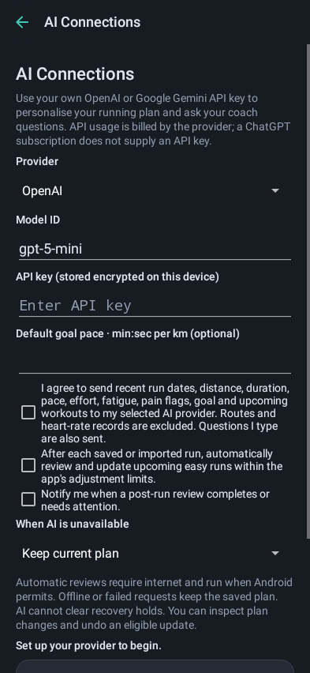

**2. Enter the desired distance and pace.** Start the AI plan and set both goals before generation.
This example targets 10 km at 6:30 min/km.

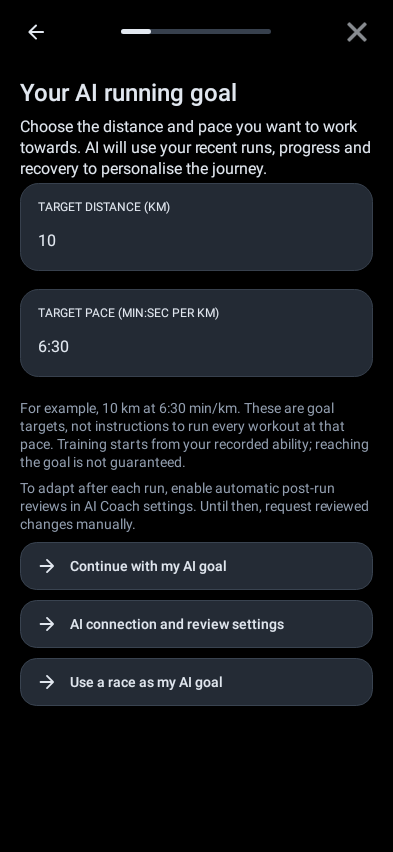

**3. Choose the training weeks and available days.** Select AI personalised plan to continue;
the standard-plan alternative remains available.

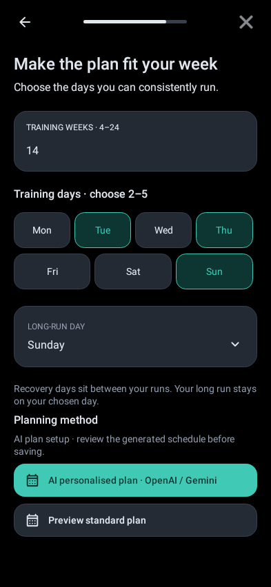

**4. Inspect the generated preview.** The saved goal, explanation and first-week workout
instructions are visible together. Use **Review all workouts** further down the page before
confirming **Create my plan**. Training paces start from recorded ability rather than immediately
prescribing the desired goal pace.

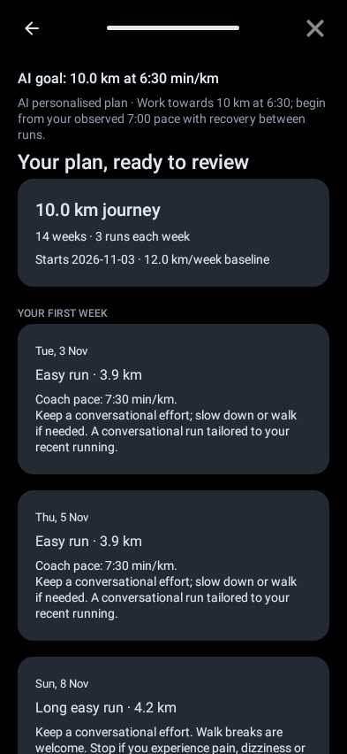

**5. Ask about recent runs.** Questions also work before a plan exists. The answer appears below
the question and does not change the schedule.

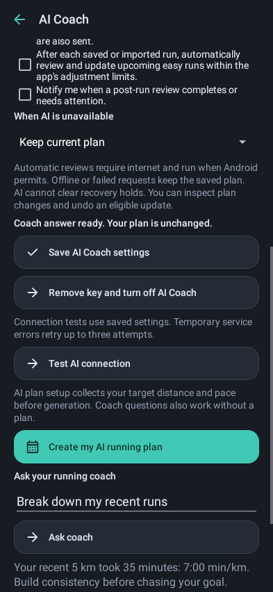

Enable **After each saved or imported run** in AI Coach settings to schedule automatic reviews of upcoming easy sessions against the saved distance/pace goal. Pace targets follow recorded ability, with bounded gradual changes; choosing a faster goal alone does not authorise faster workouts. Android decides when background work runs, so updates are not immediate. Choose the failure policy in AI settings: keep the current plan, retry automatically for eligible transient failures, or pause AI reviews. Check plan-change history and notifications for results.

**If AI returns HTTP 503:** this usually indicates the selected provider/model is unavailable, not necessarily an invalid key. Foreground requests retry eligible temporary errors with bounded backoff; persistent failure leaves the plan unchanged. Verify the exact model ID and provider access, then retry later or choose a supported model. HTTP 401/403 suggests an authentication/access problem; 429 may indicate rate or quota limits. Avoid repeatedly generating a plan while the provider is unavailable. See [AI Coach setup, retry policy and data disclosure](AI-COACH.md).

AI Coach shares a bounded recent-run summary, goal and workout context with the chosen provider after consent. It does not send GPS routes or raw heart-rate records in its documented coaching payload. Typed questions are sent verbatim. Provider billing and retention policies apply. Removing the key stops future coaching requests but does not erase your saved activities or plans.

## Use Health Connect

Health Connect integration is available through the Android 14+ framework API; older Android versions can still use core OpenRun features.

1. Open **Profile → Connected apps & devices → Health Connect**.
2. Enable **Read from Health Connect** and grant the Android permissions for the data you want imported.
3. Run the available import/synchronisation action and inspect **Progress** for imported activities.
4. To export eligible OpenRun recordings, separately enable **Write to Health Connect** and review the export action and records.

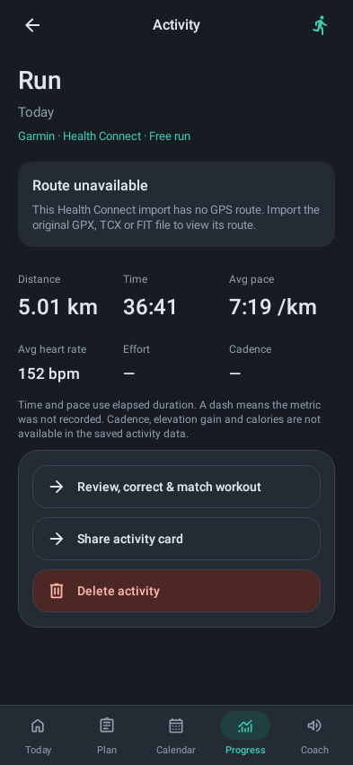

*Example imported-activity detail with unavailable route, rendered from native Android Views using synthetic data.*

Reading and writing are independent permissions. Imported activities are not re-exported as if OpenRun created them. Imported records may lack routes, precise times or heart-rate information; missing fields remain missing. If an import does not appear, confirm that the source app actually wrote a compatible run/walk record into Health Connect and that OpenRun has read permission. Device acceptance is still pending; consult [Health Connect details](HEALTH-CONNECT.md).

## Discover races and use other devices

Race discovery uses cached event information and supported catalogue providers. Refreshes depend on network availability and Android background scheduling; missing or outdated provider information is not proof that a race has been cancelled. Follow the original event source to verify registration details.

Compatible Bluetooth heart-rate devices can provide optional live observations with appropriate permissions. Health Connect history is **not** a live heart-rate stream. Garmin **account sync is not implemented**; importing a supported activity file is not equivalent to connecting a Garmin account. Do not expect Garmin Connect activities to appear unless they have been written into a compatible Health Connect record by another supported app or explicitly imported.

## Manage your data and privacy

Core planning and recording work offline. Activities and training history are stored locally; optional backups and file exports can contain sensitive health and location information. Keep exported files private and store backups securely. Follow the app's reviewed backup/export flow rather than clearing app storage. API credentials are encrypted locally and excluded from portable training backups; after device transfer you must re-enter credentials and consent.

Check [README](../README.md), [AI privacy details](AI-COACH.md) and [Health Connect permissions](HEALTH-CONNECT.md) before enabling cloud features.

## Troubleshooting

| Symptom | What to check |
| --- | --- |
| APK will not update | Verify signing certificate and version; preserve the installed app and data. |
| GPS route missing or inaccurate | Location permission, GPS fix, battery restrictions and outdoor visibility. |
| No audio coaching | Profile audio setting, phone volume, text-to-speech voice and audio focus. |
| Indoor distance looks wrong | Phone step sensor, consistent placement and stride calibration. |
| No Health Connect imports | Android version, read permission, compatible source records and available metrics. |
| Garmin account will not connect | Direct Garmin account sync is not supported yet. |
| AI connection test fails | Save settings first; verify provider, model ID, API billing/quota and internet. |
| AI plan not generated | Check consent, connection status, provider response and plan review step; existing plan remains intact on failure. |
| Automatic AI update did not run | Confirm opt-in, saved running evidence, network and background job scheduling; review failure policy. |
| Undo is unavailable | Only the newest eligible plan change can be undone; completed sessions and holds are protected. |

For reproducible problems, open a [GitHub issue](https://github.com/mmphego/OpenRun/issues) with the app version, Android version, steps, expected/actual result and **redacted** screenshots. Never attach API keys, GPS tracks, personal health records or private backups.

## Safety and limitations

Training guidance is software-generated and has not been clinically validated. Stop or reduce activity if pain develops and seek qualified medical advice when appropriate. The app cannot diagnose injuries or clear recovery holds automatically. GPS, heart-rate alerts, pace predictions and AI suggestions are informational, not emergency monitoring.

OpenRun is in beta. Live AI-provider behavior, background recording, audio routing and Health Connect on physical devices have outstanding acceptance work. See [remaining gaps](../REMAINING-GAPS.md), [roadmap](../ROADMAP.md) and [voice-coach limitations](VOICE-COACH.md).
